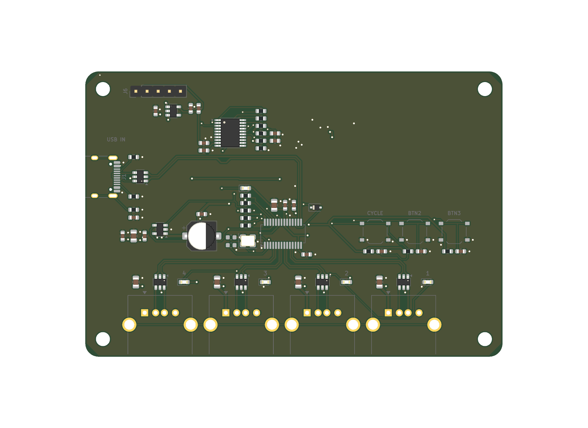

<h1 align="center">
  AUB
   
</h1>
<h4 align="center">
Yet another USB HUB
</h4>

  <a href="#key-features">Key Features</a> •
  <a href="#pcb">PCB</a> •
  <a href="#credits">Credits</a> 

&nbsp;

# AUB

AUB is a 4-port USB 2.0 hub built around the WCH CH334U, with a USB-C upstream connection and 4 USB-A downstream ports.

wanted to build my own USB hub instead of buying another generic one. AUB is designed from scratch in KiCad, with proper power switching, ESD protection and a little CH32V003 MCU for the additional controls and status indicators.

the board also has 3 physical buttons and 5 status LEDs. everything is on one PCB, including the hub controller, power circuitry and the supporting MCU.

to build your own, grab the KiCad files, check out the schematics and BOM, and send the Gerber files to your preferred PCB manufacturer. the CH32V003 can be programmed through the SWIO header.

## Key Features

* **WCH CH334U** USB 2.0 hub controller with 4 downstream ports
* **USB-C** upstream connectivity
* **4x USB-A** downstream ports
* **CH32V003** MCU for additional controls and status indicators
* **Power management** using AP2161 with overcurrent reporting
* **ESD protection** on USB data lines using USBLC6-2SC6
* **3 physical buttons** for cycle, mode and brightness controls
* **5 status LEDs** for visual feedback
* **3.3V regulation** using AP2112K
* **4-layer PCB** designed in KiCad

## PCB

designed in KiCad with a 4-layer stackup. the layout includes the USB hub circuitry, MCU, power management and all the supporting components on a single board.

the USB connectors are positioned along the board edges, with the hub controller and its supporting circuitry grouped together. spent quite a bit of time adjusting placement and routing to keep things reasonably clean.

## Files

the repository includes the KiCad project files, schematics, BOM, Gerber exports and component placement files.

everything is open source, feel free to take a look, modify it or build your own!

### Schematic

---

### PCB Layers

#### F.CU

#### B.CU

## PWR

## GND

---

### Board Views

#### Front

#### Back

### Zine

## Credits

This project uses:
- [KiCad](https://www.kicad.org/)]
- [Hack Club Embassy](https://embassy.hackclub.com)

## License

GPL
